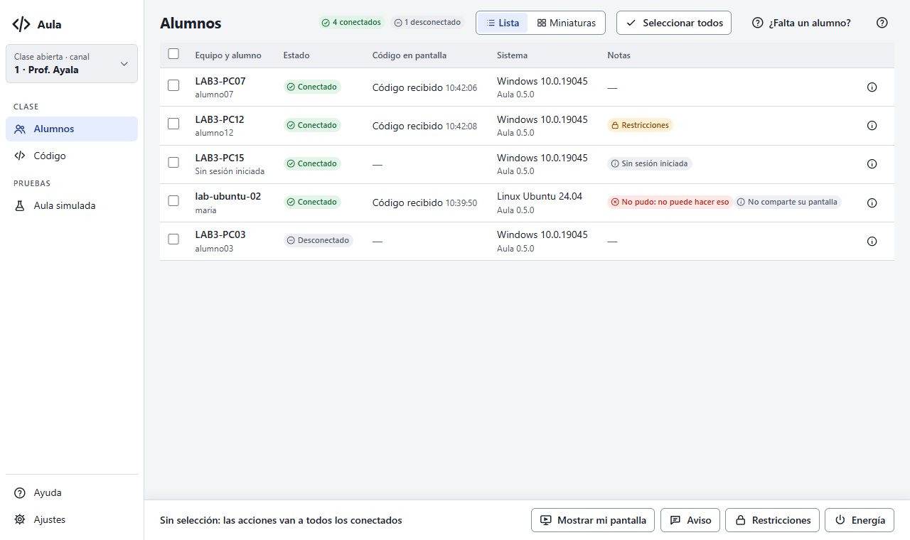
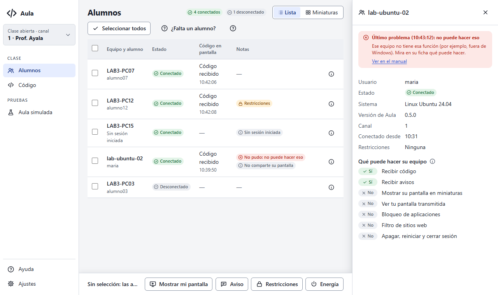
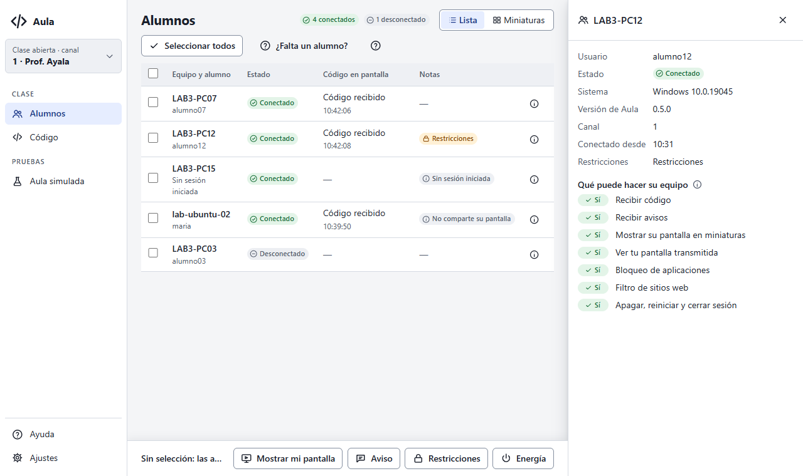
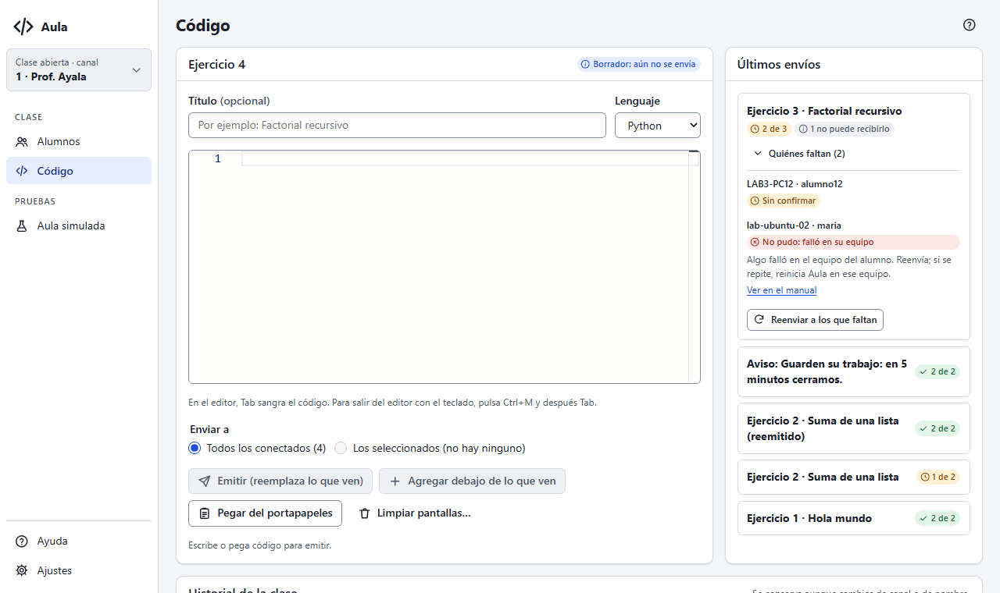
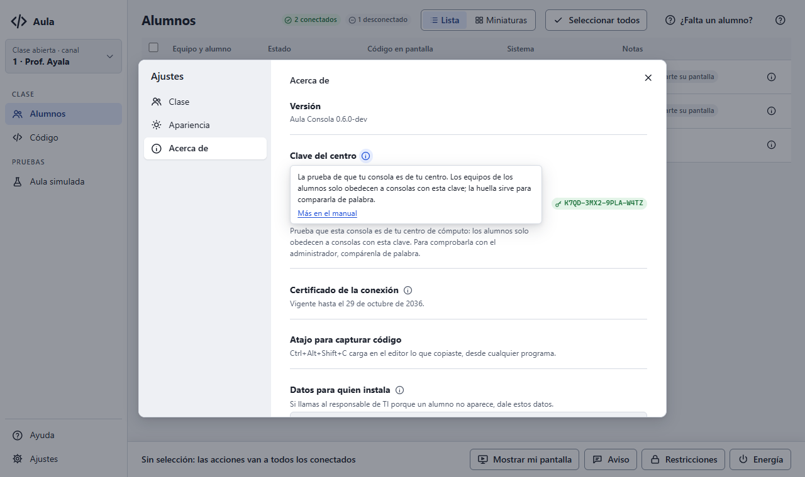
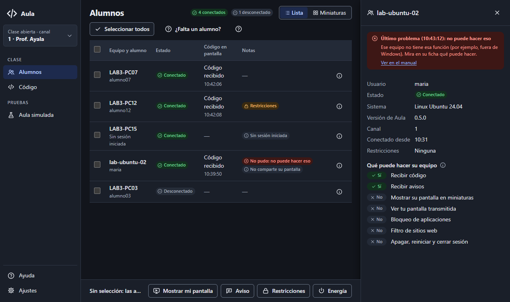
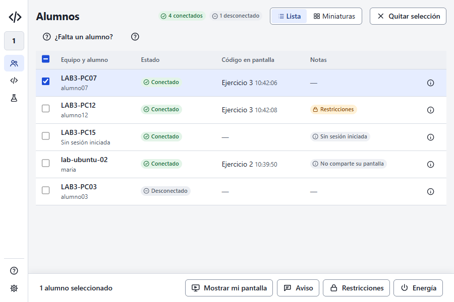

# Entrega: pendientes de las Fases 3 y 4

Estado: **para aprobación**. Cierra lo que faltaba de las Fases 3 (mejoras de UX/UI) y 4 (manual)
del prompt 18, salvo «Recoger» y «Recursos», que son funciones nuevas para otra etapa. Sin
cambios al protocolo.

## Qué cambió

- **Errores que mandan los alumnos** (Fase 3.4):
  - antes, la consola ignoraba el mensaje `error` del protocolo salvo en energía;
  - ahora un error que contesta a un envío saca al alumno de «pendiente» y lo lista aparte
    (`rejected`) con su motivo, y «Reenviar a los que faltan» también lo reintenta;
  - cualquier error queda como «No pudo: …» en las notas del alumno y en su ficha;
  - cada código del protocolo tiene un mensaje claro y un enlace al manual (sección nueva
    «El equipo del alumno no pudo hacerlo»).
- **Ficha de un alumno** (Fase 3.2): un botón «i» al final de cada fila abre a la derecha:
  - usuario, estado, sistema, versión de Aula, canal, hora de conexión y restricciones;
  - «Qué puede hacer su equipo», con Sí/No por función;
  - su último problema, con qué hacer.
- **Columna Sistema** (Fase 3.2): SO y versión de Aula. Se esconde en ventana angosta o con un
  panel abierto; el dato sigue en la ficha.
- **Información junto a los campos técnicos** (Fase 4.2): un «i» que explica el canal, la clave
  del centro, el certificado, los puertos y las capacidades, con «Más en el manual». Es un
  componente nuevo del sistema de diseño (`.info-boton`, `.info-globo`).
- **Vencimiento del certificado** (Fase 3.1): en Ajustes › Acerca de. Solo informativo: los
  alumnos fijan la huella y no revisan fechas, y dura 10 años (ver `PROPUESTAS.md`).
- **Capturas automáticas del manual** (Fase 4.1): el arnés web pasa al repo (`scripts/ux/`).
  - `recorrido.mjs` recorre 41 pantallas con axe-core y falla con errores de JS o violaciones
    serias.
  - `capturas-manual.mjs` regenera `docs/v1/administracion/img/` (se agregó `ficha-alumno.png`).
  - El manual llega de Go por `TestExportManualForUX`, que solo corre si el arnés lo pide.
- **Propuestas** (`docs/v1/ux/PROPUESTAS.md`): «Nombre del estudiante» y «Último sitio web»
  necesitan cambiar el protocolo (y, el segundo, una regla de privacidad); la columna «Canal» no
  aporta porque todos están en el mismo.

## Pruebas nuevas

| Prueba | Qué exige |
|---|---|
| `codedist` `TestDeliveriesReject` | Un error saca al alumno de pendientes, se cuenta una vez y el reenvío lo vuelve a pendiente |
| `apps/teacher` `TestAgentErrorRejectsDeliveryAndMarksStudent` | De punta a punta: el error marca el envío y al alumno, y «Reenviar» lo reintenta |
| `apps/teacher` `TestAgentErrorCodesLinkToTheManual` | Lee los códigos de `internal/protocol/errors.go`: cada uno tiene texto y sección del manual |
| `apps/teacher` `TestTextsAreComplete` (ampliada) | También los textos de cada `data-info` y de `errorAlumno.*` |
| `security` (ampliada) | `Certificate.NotAfter` |

## Capturas

Del arnés (`scripts/ux/recorrido.mjs`): 41 capturas sin errores de JS ni violaciones de axe. Las
de esta entrega están en `fases-3-4/`:

| | |
|---|---|
|  |  |
|  |  |
|  |  |
|  | |

## Pendiente

- Probar en la ventana real: casos C-26 a C-30 de `docs/desarrollo/probar-consola-local.md`.
- Correr el arnés en CI (Fase 7, E10).
