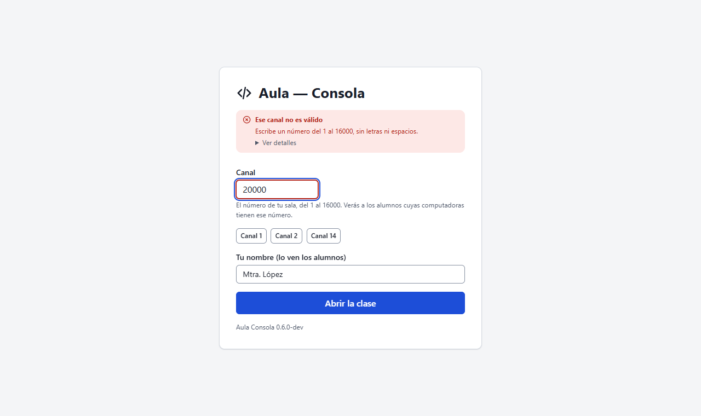
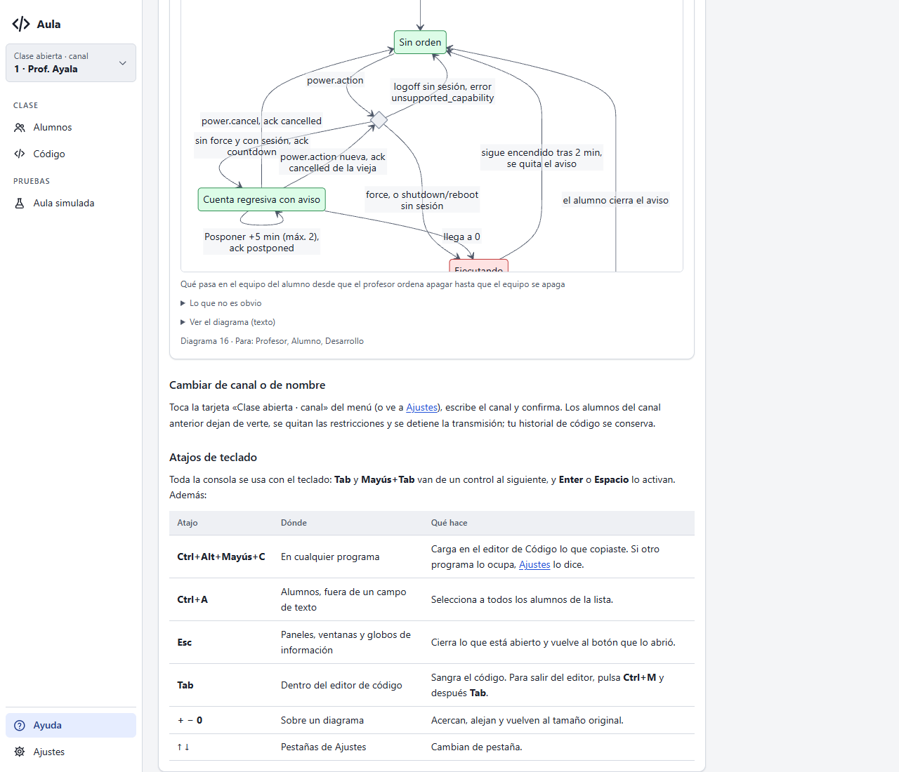

# Entrega del Paso 4: teclado, formularios y carga

Estado: **para aprobación**. Es el Paso 4 del plan de cierre de la etapa 18: revisión de las Fases
3.5, 3.6, 3.7 y 6.1, sin funciones nuevas. Solo cambian la interfaz (`main.js`, `index.html`,
`textos.es-MX.js`), el manual y el arnés.

## Atajos de teclado (3.6)

- Ya funcionaban:
  - **Ctrl+A** en Alumnos;
  - **Esc** en paneles, diálogos y globos de información;
  - **+ − 0** sobre un diagrama;
  - las flechas en las pestañas de Ajustes;
  - el atajo global de captura.
- **Arreglado:** al cerrar un panel lateral con Esc o con su botón, el foco se perdía en la página.
  Ahora vuelve al botón que lo abrió.
- **Manual:** la tabla «Atajos de teclado» en Tareas frecuentes.
- No agregué atajos nuevos.

## Formularios (3.5)

Tres ayudantes nuevos en `main.js`: `errorEnCampo`, `limpiarCampo` y `ocupado`. Con ellos, todos
los formularios siguen la misma regla. El error sale junto a su campo, que queda marcado
(`aria-invalid`) y con el foco. Lo escrito no se borra y la marca se quita al escribir. Un botón
que espera respuesta no se puede volver a pulsar.

| Formulario | Antes | Ahora |
|---|---|---|
| Arranque (canal y nombre) | Si «Abrir la clase» fallaba, volvían el canal y el nombre predeterminados: **se perdía lo escrito** | Se conserva; un canal o nombre rechazado queda marcado y con el foco |
| Cambiar canal o nombre | Un rechazo de Go salía en un aviso flotante | Sale junto al campo, sin cerrar el diálogo |
| Aviso | Un aviso no válido salía en un aviso flotante, y el botón se podía pulsar dos veces | Junto al campo, y el botón espera |
| Restricciones | Sin foco al fallar | Foco en la lista; el botón espera |
| Código: «Emitir» y «Agregar» | **Dos clics rápidos mandaban dos ejercicios** | Los dos botones esperan la respuesta |
| Aula simulada | «Agregar» se podía pulsar varias veces | Espera |
| Energía | Solo opciones y una confirmación, sin texto que perder | Sin cambios |

## Estados de carga (3.7)

- Abrir la clase ya mostraba «Abriendo el canal…».
- **Manual:** ahora muestra «Cargando el manual…» mientras llega. Si falla, sale el error.
- **Arreglado:** un enlace a una sección del manual caía antes de la sección cuando había
  diagramas arriba, porque estos toman su altura al decodificarse. Ahora vuelve a la sección
  cuando están listos.
- Los envíos ya mostraban el botón ocupado.

## Primer uso (6.1) y Fase 4.3

Sin cambios. El estado vacío ya ofrece el aula simulada; la prueba del usuario nuevo del Paso 5
dirá si alcanza. El enlace con el diagnóstico de la etapa 15 queda para esa etapa.

## Arnés

- Recorrido: 52 capturas sin errores de JS ni violaciones de axe.
- Escena nueva: abrir la clase con un canal que Go rechaza. Los dobles (`dobles.js`) ahora pueden
  rechazar, como lo hace Wails.

| | |
|---|---|
|  |  |

## Pendiente

Probar en la ventana real los casos C-38 a C-42 de `docs/desarrollo/probar-consola-local.md`.
